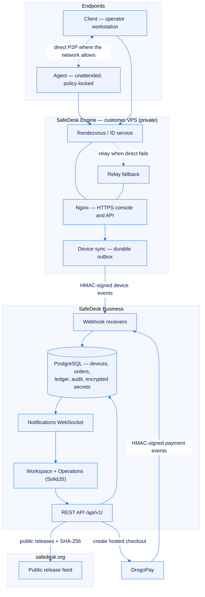
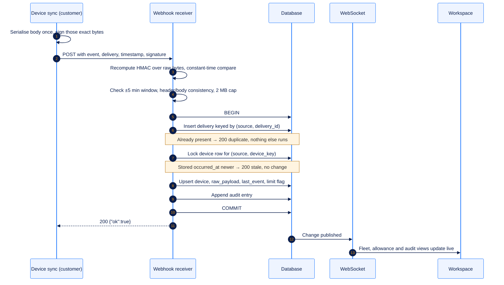

# Architecture

[← Documentation index](README.md) · [SafeDesk overview](../README.md)

SafeDesk is one platform presented through three surfaces. Each surface has a different audience, a different threat model and a different set of credentials — but they share one identity model, one device projection and one audit trail.

## The three surfaces

| Surface | Runs where | Audience | Trust posture |
|---|---|---|---|
| **SafeDesk Business** — [safedesk.business](https://safedesk.business/) | SafeDesk infrastructure, behind a Cloudflare-fronted edge | The company providing support | Receives signed events; never dials out to customer infrastructure |
| **SafeDesk** — [safedesk.org](https://safedesk.org/) | SafeDesk infrastructure | The person receiving help | Public, unauthenticated; serves only release metadata marked public |
| **SafeDesk Engine** | The customer's own VPS | The customer's infrastructure team | Outbound only; holds the source credentials, never shares them with SafeDesk |

## Component map

## Trust boundaries

| Boundary | Direction | Credential | Notes |
|---|---|---|---|
| Endpoint ↔ endpoint | Peer-to-peer, relayed only on fallback | Session-scoped | Direct paths are preferred for latency; the relay exists for networks that block them |
| Engine → SafeDesk Business | **Outbound only** | Per-source 256-bit HMAC secret | The secret is generated by SafeDesk operations and shown exactly once |
| Browser → SafeDesk Business | Same-origin | `HttpOnly` `Secure` session cookie + `X-CSRFToken` on writes + `X-Organization-ID` | The server is the authority; hiding a control in the UI is not an authorization check |
| DrogoPay → SafeDesk Business | Inbound signed webhook | DrogoPay webhook secret | The browser redirect carries no authority at all |
| SafeDesk Business → customer server | **Never happens** | — | No source-server API token is requested, accepted or stored |
| SafeDesk staff → a customer workspace | Explicit, audited | Staff identity + TOTP + deliberate `X-Organization-ID` | Staff act through the Operations workspace, never as a customer role |

The most important line in that table is the fifth one. A control plane that holds an API token for every customer's server is a single breach away from controlling every customer's fleet. SafeDesk removes that class of incident by never possessing the token in the first place — the only thing it can lose for a given customer is a receive-side HMAC secret, which grants the ability to *write device records into that one organization* and nothing else.

## The path of one device event

If any step inside the transaction fails, the whole transaction rolls back and the sender receives `500`. It then retries the identical body with the same `delivery_id`, so a partial write is not a state SafeDesk can end up in.

## Technology

| Layer | Stack |
|---|---|
| Browser applications | SolidJS + Vite — the customer workspace, the Operations workspace and both marketing sites |
| Application server | Django — the authority for authentication, tenant isolation, permissions, billing, devices and audit records |
| Data | PostgreSQL, with the full source device object retained as JSONB for forward compatibility |
| Realtime | WebSocket notifications, with the organization IP allowlist enforced on the socket |
| Edge | Cloudflare in front, Nginx at the origin; the application listener is never exposed directly |
| API contract | REST under `/api/v1/`, published as an OpenAPI 3 schema |
| Payments | DrogoPay server-to-server, hosted checkout, webhook-only fulfilment |

## Design rules the codebase holds itself to

1. **The server decides.** Every organization-scoped request carries `X-Organization-ID`, and membership is checked server-side. A hidden button is not a permission.
2. **One direction of trust per boundary.** Nothing in SafeDesk needs credentials that let it act inside a customer's network.
3. **Money and audit are append-only.** Ledger entries and audit events are never updated or deleted; corrections are new entries.
4. **Redirects prove nothing.** Only a verified, deduplicated webhook may change commercial state.
5. **Secrets are shown once.** Source and webhook secrets are stored encrypted and cannot be displayed again; rotation is the recovery path.
6. **Degrade visibly.** An over-limit device is flagged, not dropped. An expired presence reads *Offline*, not *unknown*. A disputed payment parks in `review` rather than guessing.

## Related

- [The signed device webhook](device-webhook.md) — the contract in full
- [Security model](security-model.md) — controls and non-claims
- [SafeDesk Engine](engine.md) — the customer-side deployment
- [Developer API](api.md) — the REST surface
