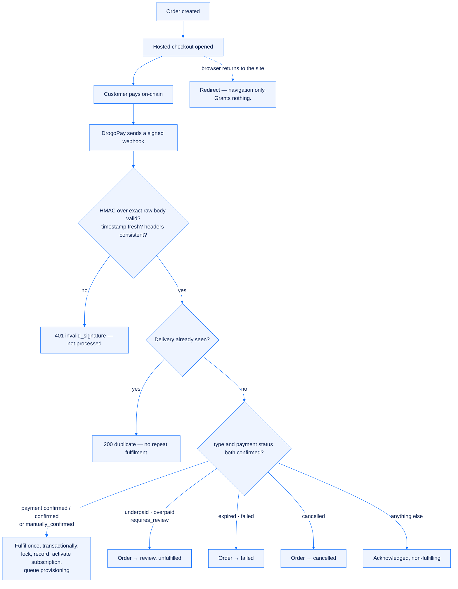

# Billing and payments

[← Documentation index](README.md) · [SafeDesk overview](../README.md) · [Live guides](https://safedesk.business/docs/billing-subscriptions-and-balance)

SafeDesk separates commercial **orders**, provider **payments**, **subscriptions**, **balances** and immutable **ledger** entries. The rule that ties them together is short: **a browser redirect or a checkout page is never proof of payment.**


## Plans

A plan defines a monthly price, a device limit and a 30-day duration.

| Plan | Devices | Monthly |
|---|---|---|
| **Starter** | 1,000 | $1,500 |
| **Growth** *(most popular)* | 2,000 | $2,000 |
| **Enterprise** | 5,000 | $4,000 |

Every plan includes the full platform. You choose the allowance and the term — not a feature tier.

## Terms and discounts

Any plan can be bought for 1, 2, 3, 6 or 12 months in a single order. **Only longer terms are discounted, and 10 % is the maximum.**

| Term | Discount | Starter | Growth | Enterprise |
|---|---|---|---|---|
| 1 month | — | $1,500 | $2,000 | $4,000 |
| 2 months | 3 % | $2,910 | $3,880 | $7,760 |
| 3 months | 5 % | $4,275 | $5,700 | $11,400 |
| 6 months | 7 % | $8,370 | $11,160 | $22,320 |
| 12 months | 10 % | $16,200 | $21,600 | $43,200 |

The server computes the amount, the discount and the subscription length from the plan and the term. **A price sent by a client is ignored.** The total is charged once for the whole term, and the plan's device limit and monthly price never change mid-term.

## What a plan unlocks

A workspace without an active subscription can sign in, read its own organization, buy a plan, fund its balance, read notifications and talk to support. Everything else — devices, agents, downloads, provisioning, IP restriction, members, activity and organization settings — answers `402`:

```json
{ "error": { "code": "subscription_required",
             "message": "An active subscription is required to use this workspace.",
             "details": {} } }
```

Two details matter here:

- **Access is granted only by a verified payment**, never by a checkout redirect, and it ends the moment the end date passes — checked on every request rather than waiting for an expiry sweep.
- **Nothing is destroyed while unpaid.** Existing devices, notes and agents are preserved; paying again restores them untouched.

The workspace re-reads its entitlement roughly once a minute while a tab is visible, and immediately when the tab regains focus — so a payment confirmed by the webhook unlocks the workspace without a reload.

## Renewing, extending and switching

Every plan order carries a **kind** that states what paying it will do.

| Kind | When | Effect of payment |
|---|---|---|
| `subscription` | No live plan | A new term starts now |
| `renewal` | Same plan as the live one | The paid months are **added** to the current end date — paying early never costs you days already bought |
| `upgrade` | A different plan while one is live | The running term closes and the new plan starts now |

Seven days before the end date a renewal reminder appears with the days remaining. Open orders that are not finished yet are listed newest first with a **Pay now** button, and choosing a plan for a term that already has a payable order **reuses that order** instead of creating a duplicate.

## Orders and checkout

Order states:

```text
pending → payment_pending → paid → provisioning → fulfilled
                                 ↘ failed · review · cancelled
```

Checkout is initiated for an existing order and accepts an asset, a network, and a success and cancel URL — both of which must be HTTPS URLs on `safedesk.business`; anything else is rejected. The response carries the hosted checkout URL and a payment ID.

**Supported asset and network combinations:**

| Asset | Networks |
|---|---|
| BTC | Bitcoin |
| ETH | Ethereum |
| USDC | Ethereum, Solana |
| USDT | Ethereum, BSC, Tron |
| BNB | BSC |
| SOL | Solana |
| TRX | Tron |

Alternatively, an order can be paid from the organization's internal balance.

## What confirms payment



SafeDesk fulfils **once**, and only on the first verified event where both the event type and the payment status agree:

- `payment.confirmed` with status `confirmed`, or
- `payment.manually_confirmed` with status `manually_confirmed`.

The first verified fulfilment locks the payment and order transactionally, records the fulfilment time, moves the order to provisioning, creates an active subscription using the plan's snapshotted limit and duration, and queues a provisioning job. The same delivery ID is later acknowledged as a duplicate without repeating any of it, and a later confirmed event cannot fulfil again once a fulfilment time exists.

**A `2xx` response from the webhook endpoint means the webhook was accepted — not that money was credited or an order was fulfilled.**

Things that must never mark an order paid: a redirect, a screenshot, a user-supplied transaction hash, a frontend message, an e-mail, or an unverified callback. "Manual confirmation" means a verified `payment.manually_confirmed` webhook — **not** a staff database edit.

## The DrogoPay webhook contract

DrogoPay is a **server-to-server** integration. Credentials stay in SafeDesk backend configuration; the browser application never calls DrogoPay and never receives a signing secret.

| Header | Content |
|---|---|
| `X-DrogoPay-Signature` | `t=<unix-seconds>,v1=<lowercase-hex-hmac>` |
| `X-DrogoPay-Timestamp` | Must equal `t` inside the signature |
| `X-DrogoPay-Event` | Must equal the JSON body's `type` |
| `X-DrogoPay-Delivery` | Unique delivery ID |

```text
signature = HMAC_SHA256(webhook_secret, UTF8(timestamp + ".") + exactRawBody)
```

Maximum timestamp difference is five minutes, and HMAC values are compared in constant time.

| Status | Meaning |
|---|---|
| `401 invalid_signature` | Missing secret, malformed signature, stale timestamp or HMAC mismatch. Not processed. |
| `400 invalid_request` | Malformed JSON, or event/header mismatch. |
| `404 not_found` | The payment ID has no SafeDesk mapping. |
| `200` duplicate | Already accepted. Do not redeliver under a new ID. |
| `5xx` | Transactional processing failed; the provider may retry the same delivery. |

Delivery deduplication and the business mutation share one transaction, so a processing failure can never leave a delivery marked complete while fulfilment rolls back.

## Balance and the immutable ledger

The organization balance is read-only in the tenant API. Ledger history is read-only too, filterable by kind and searchable by reference or description.

| Kind | Meaning |
|---|---|
| `credit` | Money added — a top-up or a staff credit |
| `debit` | Money spent — a subscription or an upgrade |
| `adjustment` | A staff correction, always with a recorded business reason |

- **Entries are immutable.** They cannot be updated or deleted.
- **Balance mutation and ledger insertion occur under database row locks.**
- **A debit that would make the balance negative is refused.**
- **Corrections are new compensating entries**, never rewritten history. Staff adjustments write both an immutable ledger entry and an audit event, with the balance row locked for the duration of the write.

## Reconciliation

Match organization, order ID, SafeDesk payment ID, delivery ID, event type, UTC timestamps, amount and state. Then confirm:

1. a verified webhook delivery exists;
2. duplicate deliveries were handled;
3. the immutable ledger and the current balance agree;
4. the provisioning job and subscription state are consistent.

Escalate discrepancies. Never change records manually.

## Provisioning

After fulfilment, an order moves through an operator-run queue: `paid → queued → provisioning → ready`. The status message and the estimated time are written by a SafeDesk operator, and the workspace shows a live countdown against that estimate. During provisioning, operators create the organization's device source and hand over the shown-once webhook secret.

## Trial terms

A trial is opened by SafeDesk operations, not requested self-service: three days, up to 20 devices, no payment. One trial per company, ever — it cannot be extended, and a company with an active plan or an earlier trial is refused. When the trial ends, the workspace is gated exactly like an expired plan.

## Troubleshooting

| Symptom | What to do |
|---|---|
| Returned from checkout, still pending | Wait for the verified webhook. Do not force fulfilment. |
| Order in `review` | Investigate the amount or review status using approved provider tools and audit evidence. |
| Duplicate webhook | A success response with a duplicate indication is expected; fulfilment stays single-use. |
| Balance looks wrong | Reconcile ledger entries. Do not edit the balance row. |
| Payment not found | Verify the provider payment ID mapping and organization scope; preserve the request time and delivery ID. |
| Provisioning did not start after confirmation | Escalate as a transactional processing incident. Do not replay with a new delivery ID. |

Never expose DrogoPay credentials, webhook secrets, signatures or full payment payloads. SafeDesk's backend alone communicates with DrogoPay.

## Related

- [Devices and limits](devices-and-limits.md) — what the allowance you bought does
- [Security model](security-model.md) — the controls around money movement
- [DrogoPay](https://drogopay.com/) — the payment provider
