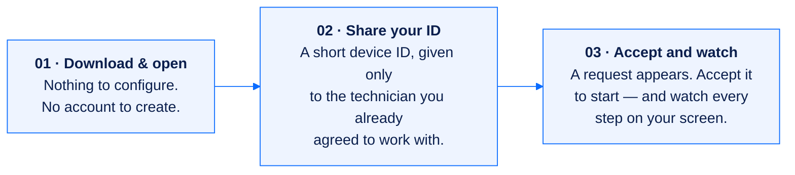

# Client experience

[← Documentation index](README.md) · [SafeDesk overview](../README.md) · [Live site](https://safedesk.org/)

[safedesk.org](https://safedesk.org/) is the other front door of the same product. It is written for **the person whose screen is being controlled** — not for the buyer, not for the engineer. No account, no email address, no phone number, no configuration.


## The promise

> *Get help on your computer — safely.* A technician you trust connects to your computer or phone — **but only when you allow it.** You see every action on your screen and can disconnect at any moment.

Four guarantees are repeated on the page because they are what the whole client side exists to deliver:

| | |
|---|---|
| **End-to-end encrypted sessions** | The session itself is encrypted |
| **You see every action** | Nothing happens off-screen |
| **Disconnect any time** | No permission needed to stop |
| **No account needed to receive help** | Free for the person receiving help; the technician's company pays |

## Three steps




The connection prompt is deliberately plain: *"Alex from IT Support wants to view and control your screen"*, with **Accept** and **Decline** given equal weight. Declining is a first-class outcome, not an obstacle.

## Company codes

If the person's employer is a SafeDesk Business customer, they may have been given a short **company code** of 2–3 characters. Entering it on [safedesk.org/downloads](https://safedesk.org/downloads) — or opening the direct link `https://safedesk.org/downloads?code=A8V` — replaces the standard public builds with exactly the installers SafeDesk operators published for that company.

- Without a code, only public builds are visible.
- Company installers are **never listed or downloadable without the code**, and an unknown code returns *not found*.
- A code is a **routing label, not a password**. Requests are rate-limited to slow guessing, but the code protects nothing on its own.

If the company also registered its own client landing page, that URL is shown to its admins as *Your client website* and can be handed to end users instead.

## Downloads and verification


Every installer is published together with its **SHA-256 checksum**, so the recipient can confirm that the file they received is the file SafeDesk built:

```bash
sha256sum "<downloaded-file>"
```

All 64 lowercase hexadecimal characters must match, compared through a trusted channel. The client documentation is explicit that **a checksum detects file changes but does not prove publisher identity on its own** — the operating-system publisher signature covers that.

Supported platforms are **Windows, macOS and Android**. If a platform is not listed in Downloads, it is not available yet.

### Per-platform install notes

| Platform | What the user does | What the system asks |
|---|---|---|
| **Windows** | Open the file, follow the steps, launch from the Start menu | A security prompt on first run. **No administrator rights are needed merely to receive help** — grant them only if the technician explains why |
| **macOS** | Drag SafeDesk into Applications, open it, confirm | **Screen Recording** so the technician can see the screen, **Accessibility** so they can move the mouse and type. Granted in System Settings → Privacy & Security, for SafeDesk only, revocable at any time |
| **Android** | Allow install from the browser once, then install | Screen capture, plus Accessibility for remote control. A persistent notification is shown while a session runs |

## Safety guidance


The site's stance is that remote-support tools are safe when used with people you know, and that **scammers rely on urgency and surprise**. The six habits it publishes:

1. **Only accept connections from people you know.** A connection request should never be a surprise. If you did not arrange the session yourself, decline it.
2. **Never share a one-time code over an unexpected call.** Legitimate technicians do not phone out of the blue asking for codes or IDs. Hang up and use a channel you trust.
3. **You can end the session at any time.** Close the session window or quit SafeDesk and the connection stops immediately. No permission is required.
4. **Keep an eye on the screen.** Everything the technician does is visible in real time. If something looks wrong, disconnect first and ask questions later.
5. **Download only from safedesk.org**, where each installer is published with a verifiable checksum.
6. **Never share passwords or banking details.** A technician does not need them. If you are asked to type them while someone is connected, stop the session.

This is anti-fraud copy on a product landing page — a deliberate choice, because the most common attack on remote-support software is social, not technical.

## Answers given on the client site

| Question | Answer |
|---|---|
| Is it free? | Yes. The app for people receiving help is free; the technician's company covers the service. |
| Do I need an account? | No account, email or phone number. Open the app, share the ID, accept the request. |
| Does it run in the background? | **Only while it is open.** Quit the app and nobody can connect. Uninstall it like any other app to remove it entirely. |
| Can the technician see my files or passwords? | During a session they see the screen and control the mouse and keyboard — like sitting next to you. **Nothing is shared before you accept and nothing after you disconnect.** Close sensitive documents first. |
| How do I end a session? | Click Disconnect, or quit SafeDesk. The technician cannot reconnect without a new request that you accept. |
| How do I uninstall? | Windows: Settings → Apps → SafeDesk → Uninstall. macOS: drag from Applications to the Bin. Android: long-press the icon → Uninstall. Nothing else needs removing. |

## Mobile

The client site is built mobile-first, because a meaningful share of people receiving help are on a phone when they are told to get it.

<p>


</p>

## Where it connects to the business side

The client site is a consumer of the same platform API:

```text
GET https://safedesk.business/api/v1/public/releases/            → public builds
GET https://safedesk.business/api/v1/public/releases/?code=A8V   → one company's builds
                                                                   + company.name, company.website_url
GET https://safedesk.business/api/v1/public/releases/{id}/download/
```

Only releases that operators marked public and that passed the ClamAV scan appear in the public feed. Authorisation is not established by installing an agent — endpoint-owner approval, user notice and any legally required consent come first. See [the security model](security-model.md).

## Related

- [Architecture](architecture.md) — how the client, business and engine surfaces relate
- [Security model](security-model.md) — acceptable use and abuse handling
- [FAQ](faq.md) — combined answers for buyers, engineers and end users
