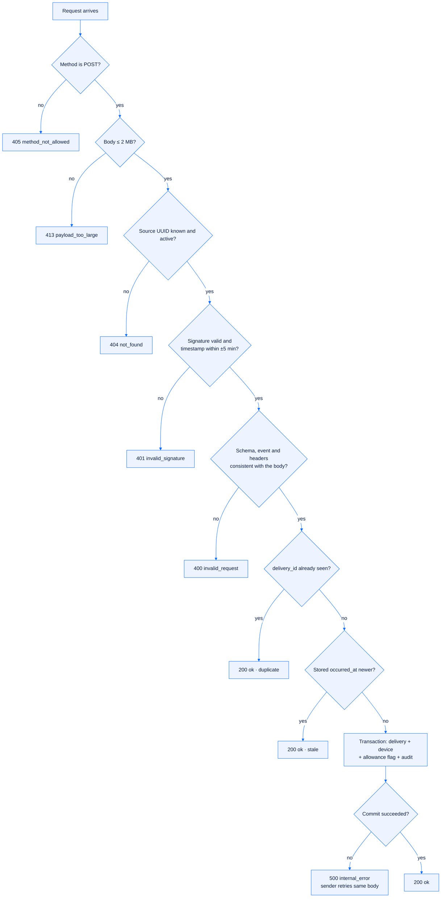

# The signed device webhook

[← Documentation index](README.md) · [SafeDesk overview](../README.md) · [Live guide](https://safedesk.business/docs/device-webhook-integration)

SafeDesk learns about devices **only** from signed webhook events that the customer's own device source server pushes to it. SafeDesk never connects to that server, never calls a source-server device API, and never asks for, accepts or stores a source-server API token.

The entire integration is two values: a per-source **webhook URL** and a per-source **webhook secret**.


## The contract

| Item | Value |
|---|---|
| Endpoint | `POST https://safedesk.business/api/webhooks/rustdesk/devices/{source_uuid}` |
| Content type | `application/json` (UTF-8) |
| Sender environment | `SAFEDESK_WEBHOOK_URL`, `SAFEDESK_WEBHOOK_SECRET` |
| Signature | `HMAC_SHA256(secret, timestamp + "." + rawBody)` → `X-SafeDesk-Signature: sha256=<lowercase hex>` |
| Timestamp tolerance | ± 5 minutes (300 s) |
| Maximum body | 2 MB (2 × 1024 × 1024 bytes) |
| Secret strength | Random 256-bit value, unique per source, generated by SafeDesk |
| Comparison | Constant-time, over the exact bytes received |

The webhook routes deliberately sit **outside** `/api/v1/`. They use no browser session and no CSRF token, because they are a different trust boundary with a different credential. Never send browser cookies to them.

## Where the credentials come from

Customers do not configure their own device sources. When a subscription is provisioned:

1. A SafeDesk operator opens **Operations → Provisioning**, selects the company and creates a device source (for example `HQ relay`), optionally recording the source server URL and region.
2. SafeDesk displays the webhook URL and the webhook secret **exactly once**. The stored copy is encrypted and cannot be shown again.
3. The operator hands both values over through a secure channel — never as a plain chat message or e-mail.
4. If the secret is lost or may have leaked, the operator uses **Rotate secret** and the customer updates the sender.

On the source server the two values live in environment variables or a secret manager. They must never be committed, logged, placed in a URL query string, or shipped to client-side code.

## Required headers

| Header | Rule |
|---|---|
| `X-SafeDesk-Event` | Must equal the body's `event`. One of `device.created`, `device.updated`, `device.deleted`. |
| `X-SafeDesk-Delivery` | Must equal the body's `delivery_id`. A UUID, reused across retries of the same delivery. |
| `X-SafeDesk-Timestamp` | Unix seconds as decimal text, within ± 300 s of SafeDesk server time. |
| `X-SafeDesk-Signature` | `sha256=` followed by 64 lowercase hex characters. The prefix is mandatory. |

A missing or mismatched header produces `400`. An invalid or expired signature produces `401`.

## The exact signing input

Serialise the JSON body **once** into UTF-8 bytes and send exactly those bytes.

```text
signed_bytes = UTF8(timestamp) + UTF8(".") + rawBody
signature    = lowercase_hex( HMAC_SHA256(secret, signed_bytes) )
header       = "sha256=" + signature
```

SafeDesk recomputes the HMAC over the raw bytes it received. This is the single most common source of integration failure, so the rules are worth stating as prohibitions. The sender must **not**:

- sign a parsed object and then let the HTTP client re-serialise it;
- pretty-print or minify after signing;
- append a trailing newline;
- change Unicode escaping or key ordering after signing;
- use uppercase hex, or omit the `sha256=` prefix.

## Body schema — `schema_version: 1`

```json
{
  "schema_version": 1,
  "event": "device.created",
  "delivery_id": "3f2b8a5e-6c7d-4e1f-9a0b-1c2d3e4f5a6b",
  "occurred_at": 1757710000,
  "source": "rustdesk-pro",
  "device_key": "guid:0f1e2d3c-4b5a-6978-8796-a5b4c3d2e1f0",
  "device": {
    "id": "123456789",
    "name": "FINANCE-WS-07",
    "user": "j.doe",
    "group": "Finance",
    "platform": "windows",
    "enabled": true,
    "online": true,
    "last_online": 1757709950,
    "version": "1.3.2",
    "ip": "203.0.113.10"
  }
}
```

| Field | Type | Rule |
|---|---|---|
| `schema_version` | integer | Must be `1`. |
| `event` | string | Must equal `X-SafeDesk-Event`. |
| `delivery_id` | UUID string | Must equal `X-SafeDesk-Delivery`; unique per delivery. |
| `occurred_at` | integer | Unix seconds of the change **on the source**. Drives stale-event protection. |
| `source` | string | Envelope context. `rustdesk-pro` for schema version 1. |
| `device_key` | string | Stable unique key within the source. This is the upsert key. |
| `device` | object | The full device record. Known keys map to columns; **every** key, including unknown ones, is retained verbatim in `raw_payload` (JSONB). |

`last_online` is accepted as Unix seconds, Unix milliseconds or an ISO-8601 string. For `device.deleted`, still send a `device` object — it may be `{}`; SafeDesk marks the device deleted and keeps its history.

The management console's own record shape is understood too, so a sender may forward it unreshaped: `info.device_name` → `name`, `info.username` → `user`, `info.os` → `platform`, with `info.version` and `info.ip` shown in the device details drawer.

## What happens to an accepted event

Everything below runs inside one database transaction.

1. Insert the delivery into the deliveries table keyed by `(source, delivery_id)`, together with the SHA-256 of the raw body. If it already exists, nothing else runs and the response is `200 {"ok":true,"duplicate":true}`.
2. Lock the device row for `(source, device_key)`.
3. If the stored device already carries a newer `occurred_at`, acknowledge `{"ok":true,"stale":true}` and change nothing.
4. Upsert the device: mapped columns, `raw_payload`, `last_event`, `source_occurred_at`, and `deleted_at` for a delete event.
5. Apply the organization's device limit. A brand-new device beyond the active subscription's allowance is stored and flagged `over_limit: true`; existing devices keep their flag.
6. Append the audit entry and commit.

If anything fails, the transaction rolls back and SafeDesk answers `500`. Only the delivery ID, event name, source UUID, HTTP status and timing are logged — never the secret, the signature, authorization values or the device payload.

## The decision tree



## Responses

| Status | Body | Meaning and sender action |
|---|---|---|
| `200` | `{"ok":true}` | Stored. |
| `200` | `{"ok":true,"duplicate":true}` | Same `delivery_id` already processed. Intentional no-op — do not resend. |
| `200` | `{"ok":true,"stale":true}` | Older than the stored state. No-op. |
| `400` | `invalid_request` | Malformed JSON, wrong `schema_version` / `event` / `source`, header ≠ body, missing field, `device` not an object. Fix the sender. |
| `401` | `invalid_signature` | Bad or expired signature, wrong secret, wrong source/secret pairing, clock skew above 5 minutes. |
| `404` | `not_found` | Unknown or deactivated source UUID. |
| `405` | `method_not_allowed` | Only `POST` is accepted. |
| `413` | `payload_too_large` | Raw body above 2 MB. |
| `429` | — | Edge rate limit. Back off and retry. |
| `500` | `internal_error` | Temporary. Retry the identical body with the same `delivery_id`. |

## Retry rules

- **Network failure, `429` or `5xx`** — retry the same body with the same `delivery_id`, using bounded exponential backoff with jitter (1 s, 2 s, 4 s … capped at 5 minutes, for up to 24 hours).
- **More than ~4 minutes elapsed** — re-sign the unchanged bytes with a fresh timestamp and keep the `delivery_id`.
- **`400`, `401`, `404`, `413`** — stop and fix the configuration or data. Retrying unchanged will fail identically.
- **Never mint a new `delivery_id`** to get past duplicate detection. It writes duplicate history.
- **Deliver events for one `device_key` in order.** `occurred_at` protects against reordering, but in-order delivery makes the fleet view correct sooner.

## Presence expires on purpose

A device is shown **Online** only while events keep arriving for it. If nothing has been received for three minutes, the panel reads **Offline** even if the last payload said `is_online: true`. The recommendation for senders is therefore to forward the console heartbeat for every connected device and, ideally, one final event with `is_online: false` on disconnect.

This is a deliberate trade. A cached "online" badge that outlives reality is worse than an honest "offline" — it sends a technician to a device that is not there.

## Sender-side hardening checklist

- Keep the webhook secret only in environment variables or a secret manager.
- Keep the source server's **own** API token out of the integration entirely. SafeDesk does not need it and refuses configuration payloads containing keys such as `RUSTDESK_API_TOKEN`.
- Sign over the exact bytes sent; use HTTPS only; verify the TLS certificate; time out at ≤ 15 s; cap in-memory retry queues.
- Log only `delivery_id`, event, HTTP status and latency.
- Keep the source server's clock synchronised with NTP — skew above 5 minutes produces `401`.
- Ask the operator to rotate the secret when staff change, a machine is decommissioned, or exposure is suspected. Update the sender atomically and test one synthetic event.

## Troubleshooting

| Symptom | Likely cause |
|---|---|
| `401 invalid_signature` on every request | Wrong secret for this source UUID; signature computed over re-serialised JSON; uppercase hex; missing `sha256=`; clock skew. |
| `401` only sometimes | A retry reused a timestamp older than 5 minutes. Re-sign with a fresh timestamp, same `delivery_id`. |
| `400 invalid_request` | Header/body mismatch on `event` or `delivery_id`; `source` ≠ `rustdesk-pro`; `schema_version` ≠ 1; `device` not an object; non-UUID `delivery_id`. |
| `404 not_found` | Source deactivated by the operator, or wrong UUID in the URL. |
| Device appears but flagged over limit | The active subscription's device limit is reached. Upgrade the plan. |
| Device never updates | Events arrive with an `occurred_at` older than the stored state. Check the source clock. |

## Data caution

Device payloads may include names, usernames, network details and other personal data. Minimise the fields the source sends, restrict who can read them, define a retention period, and never paste a full payload into a ticket or a chat message.

## Related

- [Devices and limits](devices-and-limits.md) — what happens after an event is accepted
- [Architecture](architecture.md) — where this boundary sits
- [Developer API](api.md) — the authenticated read surface
- [Security model](security-model.md) — the controls around it
