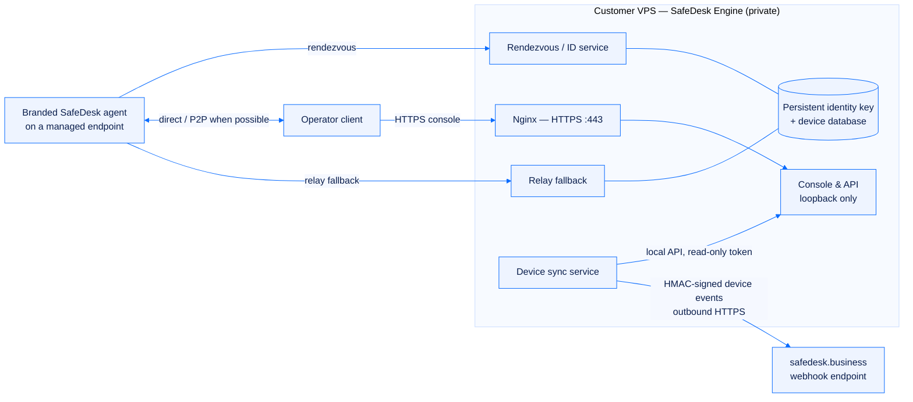

# SafeDesk Engine

[← Documentation index](README.md) · [SafeDesk overview](../README.md)

> **The Engine's deployment code is private.** This page describes what it does and why it is built the way it is. No source, script, configuration file or credential from it is reproduced here.

SafeDesk Business is a control plane. It shows a fleet, but it does not *own* the rendezvous infrastructure that the fleet connects through — the customer does. **SafeDesk Engine** is the deployment engine that turns a clean VPS into that infrastructure: a branded, self-hosted remote-support server that becomes a SafeDesk **device source**.

## Why this split exists

The alternative design is obvious and much easier to build: let SafeDesk hold an API token for every customer's server and poll it. That design puts every customer's fleet one control-plane breach away from a stranger.

The Engine exists so that arrangement never has to happen.

| | Token-holding control plane | SafeDesk |
|---|---|---|
| Who holds the source server API token | The vendor, for every customer | **Only the customer, on their own server** |
| Direction of traffic | Vendor dials into customer infrastructure | **Customer pushes outbound to the vendor** |
| Worst case if the vendor is breached | Control of every customer's fleet | A receive-side HMAC secret per organization — write device records into that one organization, nothing more |
| Worst case if one customer's server is breached | Depends on the vendor's isolation | That one customer's own server |

Everything else in SafeDesk's security model follows from that first row. See [the security model](security-model.md).

## What the Engine deploys

A fresh Ubuntu LTS host with a public IPv4 address and a direct DNS record becomes a reproducible platform consisting of:

- a **rendezvous and ID service** that clients register with;
- a **relay service** as a fallback path;
- **direct / peer-to-peer connections** preferred, for lowest latency, with relay only when the network forces it;
- an **HTTPS console and API** published through Nginx, with automatic certificate renewal;
- **strict host firewall rules**, with the console's internal port never exposed externally — Nginx reaches it over loopback;
- **near-real-time, HMAC-signed device synchronisation** to SafeDesk Business;
- **encrypted backup, restore, update and health-check** commands;
- **brand assets and locked client policy templates** for building the branded customer agent and operator client.

The upstream remote-support server is a separate commercial product with its own licence; the Engine deploys and integrates it rather than redistributing it. The deployment is idempotent — re-running it with the same configuration is safe, which is what makes it a deployment *engine* rather than a one-shot script.

## Device synchronisation

The upstream server exposes a token-authenticated devices API but **no native device-created webhook**. The Engine closes that gap with a small synchronisation service that:

- polls the local API on a short interval and derives complete `device.created`, `device.updated` and `device.deleted` events;
- **retains every unknown upstream field** rather than discarding what it does not recognise, so a server-side schema addition does not silently drop data;
- signs each delivery with HMAC-SHA256 over the exact raw body and stamps it with a replay-window timestamp;
- keeps local state plus a **durable retry outbox**, so an outage on either side is caught up rather than lost;
- assigns **idempotent delivery IDs**, which is what makes SafeDesk's deduplication meaningful end to end.

The token used for synchronisation is created with **read-only device scope** — the minimum the job needs. It lives only in a root-owned, mode-`600` environment file on the source server, and the receiving side never gets it. The receiver gets a webhook URL and one shared HMAC secret, and that is all it needs.

The contract this service speaks is documented in full on the receiving side: [the signed device webhook](device-webhook.md).

## Network exposure, honestly stated

Direct / P2P mode requires the rendezvous, NAT-test, relay and WebSocket ports to be reachable, plus `443` for the console and `80` for certificate validation and redirect. That has a consequence the Engine's own documentation states plainly rather than glossing over:

**A CDN's standard reverse proxy does not carry arbitrary TCP/UDP ports.** Direct mode therefore needs a plain DNS record, which reveals the VPS address. If origin concealment is mandatory, the honest options are relay-only WebSocket mode (higher latency, no direct P2P), an enterprise TCP/UDP proxying product, or a separately designed edge architecture. An orange-cloud DNS record should never be assumed to protect ports that the CDN does not proxy.

Also worth stating: the host firewall is not the only firewall. The hosting provider's external security group has to agree with it.

## Backup, restore and migration

Backups are taken with services briefly stopped so the identity key and database snapshot are consistent, then encrypted with AES-256 and a passphrase-derived key. The operating rules around them:

- Keep the encrypted archive and its passphrase **in separate locations**.
- Test restores regularly, on an isolated server.
- Rotate API and webhook secrets after restoring into a less-trusted environment.
- **Treat the archive as highly sensitive even though it is encrypted** — a restored private identity key allows impersonation of the server.

Preserving the identity key across a migration keeps the public key stable, which means existing deployed clients keep working. If the commercial licence was bound to a host that no longer exists, it is unbound through the vendor's licence management and re-activated on the new host; access to the old machine is not required.

## The client policy caveat

The managed-agent policy template is deliberately restrictive: permanent-password-only access, with changing that password blocked. That is the correct posture for an unattended kiosk or warehouse endpoint — and it is also a foot-gun. **A preset permanent password must be configured in the custom client build, preferably unique per deployment, or the endpoint can become inaccessible.** The Engine's documentation flags this as a caution rather than a footnote, because recovering an unattended endpoint with no valid credential usually means physical access.

## Secret hygiene

The Engine's security guide is a list of things that must never reach version control: licences, API tokens, personal access tokens, webhook URLs containing private source identifiers, HMAC secrets, preset client passwords, the private identity key, databases, certificate private keys, and backup passphrases or decrypted archives.

A `.gitignore` blocks the common filenames, and the guide says outright what that buys: it **cannot protect a secret pasted into documentation or source code.** Every commit gets reviewed before it is pushed.

If a secret is exposed: revoke and rotate it at the issuing service first, update the protected environment file, restart the affected service, purge it from history if it was committed, then inspect audit logs and webhook deliveries. **Masking a displayed value is not rotation.**

## Operational commands

The Engine installs a small set of maintenance commands rather than leaving operators to remember container invocations: a full verification health check, a container update path, log access for both the server and the synchronisation service, and the backup / restore pair. The health check is the first thing to run after any install, restore or migration.

The same caveat from [the security model](security-model.md) applies to its output: a health check that passes proves the checked components respond. It does not prove that every queue, worker, external dependency and customer workflow is healthy.

## Relationship to the hosted platform

| | SafeDesk Business | SafeDesk Engine |
|---|---|---|
| Operated by | SafeDesk | The customer |
| Hosting | Multi-tenant, Cloudflare-fronted | The customer's own VPS |
| Holds | Device records, agents, billing, audit | Rendezvous identity, sessions, the source API token |
| Talks to the other by | Receiving signed webhooks | Sending signed webhooks, outbound only |
| Sees session content | **No** | Session traffic is direct or relayed between endpoints |

SafeDesk Business is a record of *which devices exist and who may reach them*. The Engine is where the connections actually happen. Neither needs the other's secrets.

## Related

- [Architecture](architecture.md) — all three surfaces together
- [The signed device webhook](device-webhook.md) — the exact contract the Engine speaks
- [Security model](security-model.md) — the credential separation this design protects
