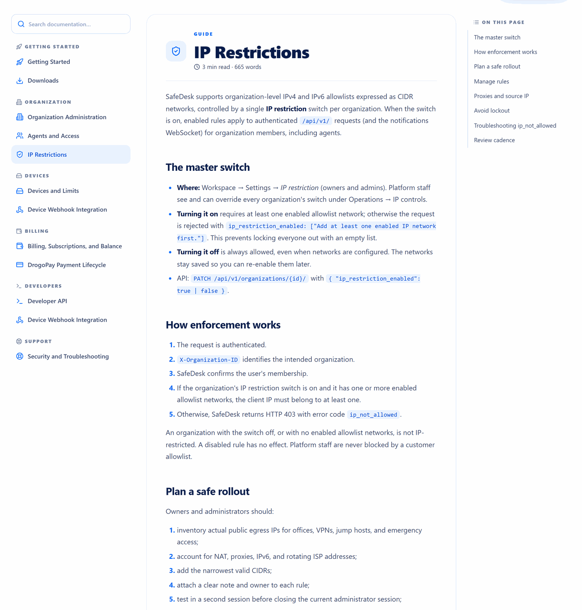

# IP restrictions

[← Documentation index](README.md) · [SafeDesk overview](../README.md) · [Live guide](https://safedesk.business/docs/ip-restrictions)

SafeDesk supports organization-level IPv4 and IPv6 allowlists expressed as CIDR networks, controlled by **one master switch per organization**. With the switch on, enabled rules apply to authenticated API requests and to the notifications WebSocket, for every member of the organization — agents included.



## The master switch

| Property | Behaviour |
|---|---|
| Where | **Workspace → Settings → IP restriction**, for owners and admins |
| Staff override | Platform staff see and can override every organization's switch under **Operations → IP controls** |
| Turning it **on** | Requires at least one **enabled** allowlist network. An empty list is refused with `"Add at least one enabled IP network first."` |
| Turning it **off** | Always allowed, even with networks configured. The networks stay saved for later. |

That asymmetry is the whole safety design. Enabling a restriction with nothing to allow would lock out every member including the person who flipped the switch, so the platform simply refuses. Disabling is never blocked, because the recovery path must always be open.

## How enforcement works

1. The request is authenticated.
2. `X-Organization-ID` identifies the intended organization.
3. SafeDesk confirms the user's membership.
4. If the switch is on **and** the organization has one or more enabled networks, the client IP must belong to at least one of them.
5. Otherwise SafeDesk returns `403` with error code `ip_not_allowed`.

An organization with the switch off, or with no enabled networks, is **not** IP-restricted. A disabled rule has no effect. Platform staff are never blocked by a customer allowlist.

## Planning a safe rollout

Owners and administrators should:

- inventory the **actual public egress IPs** for offices, VPNs, jump hosts and emergency access;
- account for NAT, proxies, IPv6 and rotating ISP addresses;
- add the **narrowest** valid CIDRs;
- attach a clear note and an owner to each rule;
- test in a second session **before** closing the current administrator session;
- verify agent access through the normal corporate path;
- document a staffed recovery procedure.

Examples in documentation use reserved ranges only:

```text
192.0.2.18/32
198.51.100.0/24
2001:db8:1234::/48
```

Never copy those into production.

## Avoiding lockout

- Add a known `/32` or `/128` test route first.
- Keep one already-authenticated administrator session open.
- Test both read and write requests.
- Verify the active organization header.
- Add VPN egress **before** requiring VPN use.
- Do **not** use `0.0.0.0/0` or `::/0` as a temporary fix — it removes the restriction's entire security value.

If you do get locked out: any owner or admin connecting from an allowed address can switch IP restriction off from Settings, and SafeDesk operators can switch it off for you from Operations → IP controls.

## Proxies and the real client IP

IP controls are only trustworthy when the edge-to-origin path validates the real client address. Cloudflare terminates public TLS and Nginx forwards to the application; the deployment must accept forwarding headers **only** from approved proxies. The private application listener is never exposed, and caller-supplied forwarding headers are never trusted directly.

If the observed address looks wrong, correct the edge or origin configuration. Do **not** broaden an allowlist to compensate for an unverified client-IP chain — that converts a configuration bug into a permanent security hole.

The protected staff route has separate operational controls and is not a customer backdoor: `/admin/` deliberately returns `404`, and staff administration lives on an environment-configured random path behind MFA, role-based access control, rate limits, IP policy and auditing.

## Troubleshooting `ip_not_allowed`

- Confirm the public egress address from the same network **and the same protocol family**.
- Confirm `X-Organization-ID` selects the intended organization.
- Check enabled rules for typographical errors and prefix length.
- Check whether VPN split tunnelling changed the route.
- Check whether the ISP or cloud NAT address changed.
- Verify trusted-proxy configuration and the logged client IP.

What not to do: retry repeatedly, disable the firewall, expose the application directly, or send session cookies to support. When escalating, provide the request time, organization ID, expected CIDR and a redacted request ID — and omit credentials and secrets.

## Review cadence

Review rules quarterly, and whenever offices, VPNs, vendors, agents or network providers change. Remove stale ranges promptly and correlate every change with its audit event.

## Related

- [Roles and permissions](roles-and-permissions.md) — the identity layer this supplements
- [Security model](security-model.md) — where IP policy sits among the other controls

> **IP policy supplements identity controls; it does not replace them.** It is not a substitute for strong passwords, MFA, session hygiene, device authorisation or audit review.
